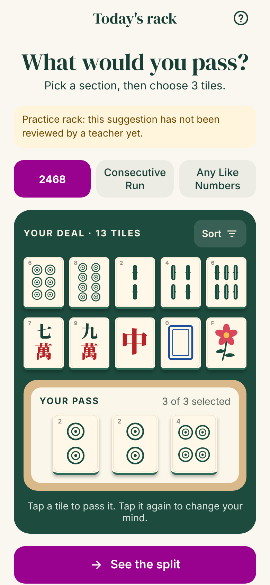
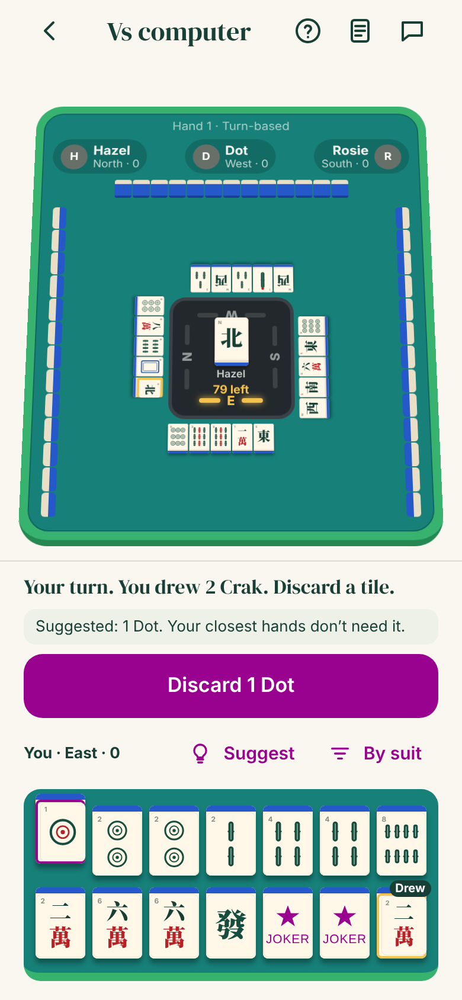
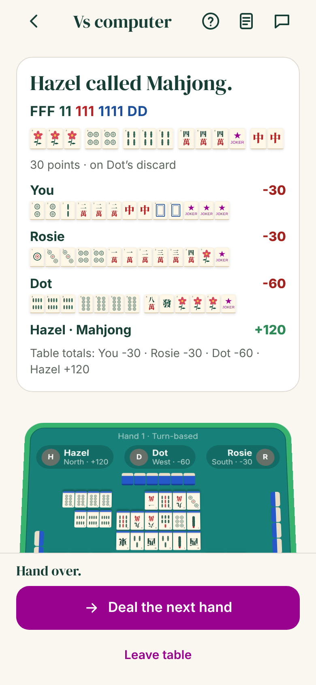
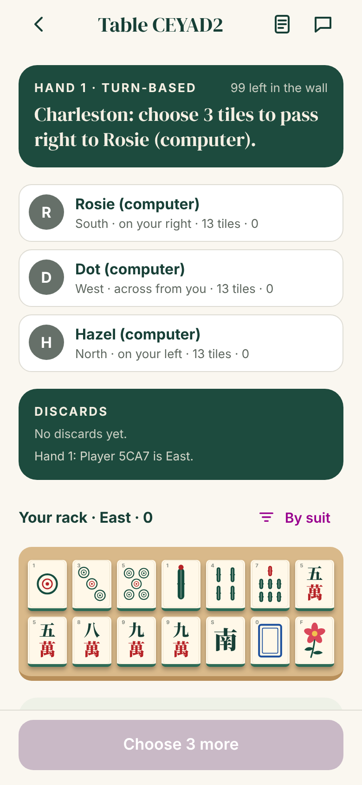
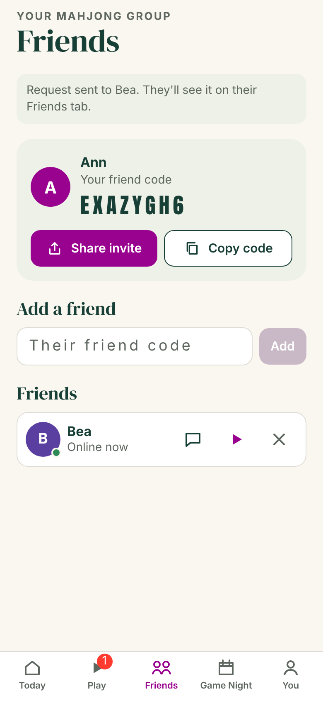
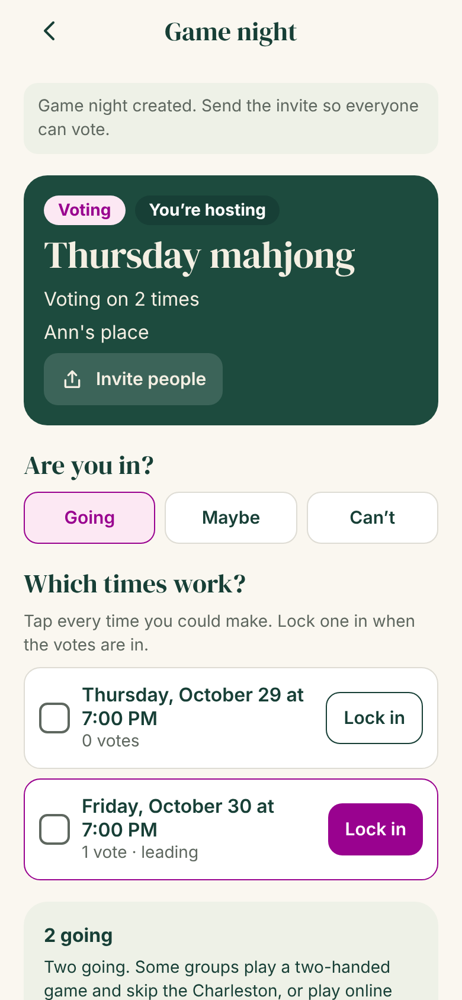
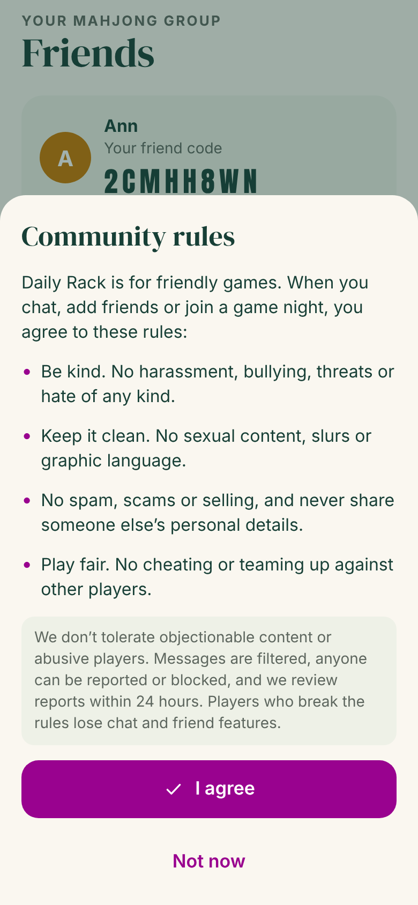
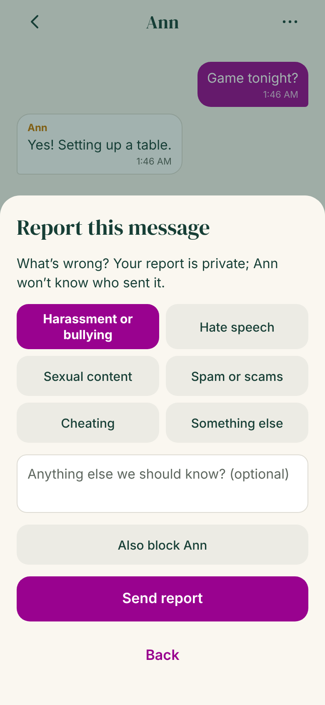
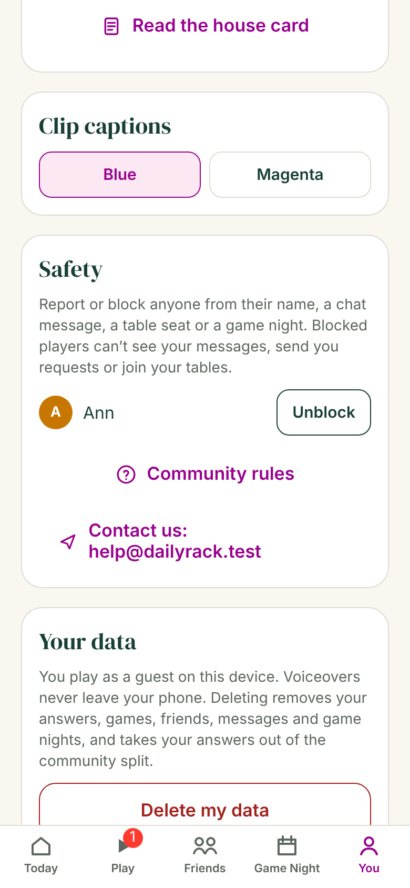
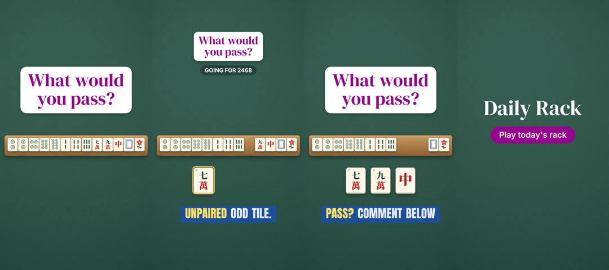

# Daily Rack

An American mahjong app with two halves:

- **The daily rack.** Everyone gets the same 13-tile deal each day. You pick a section, pass three tiles, compare your pass with one strong pass and with how everyone else passed, then export your answer as a 9:16 clip for Reels or TikTok.
- **Sit down to a game.** Full four-seat American mahjong (Charleston, courtesy pass, calling discards, jokers and joker swaps, Mahjong and payments) against computer players or with friends, live or turn-based. Friends add each other by code, chat, and plan in-person **Game Nights** with time votes, RSVPs and a calendar file, with an online table as the fallback when the group can't meet.

It is one Expo app (Expo SDK 58) for iOS, Android and the web. There is no sign-in: each player is a guest on their device. A shared link opens in any phone browser with nothing to install. Players agree to community rules before chatting, messages are filtered, and anyone can be reported or blocked (see [`docs/MODERATION.md`](docs/MODERATION.md)).

Built from the product handoff in [`docs/handoff/`](docs/handoff/README.md). What is done, what is verified and what is still open is tracked in [`BUILD-STATUS.md`](BUILD-STATUS.md).

| Daily rack | Playing a hand | Hand result |
| --- | --- | --- |
|  |  |  |

| Charleston | Friends | Game Night |
| --- | --- | --- |
|  |  |  |

| Community rules | Reporting a message | Blocked players |
| --- | --- | --- |
|  |  |  |

Exported video frames (hook, a tile sliding out with captions, the closing question, the end card):



## How it is built

| Part | What it does | Tech |
| --- | --- | --- |
| `packages/core` | Daily rack rules: tile faces, puzzle and pass validation, the community split, streaks, the content calendar, the clip timeline and caption timing | TypeScript, no dependencies |
| `packages/core/src/mahjong` | The game: the 152-tile set, the house card and its pattern language, hand matching with jokers, a pure state machine for a hand (Charleston to payments), and computer players at three strengths | TypeScript, no dependencies |
| `apps/server` | Guest sessions, the daily rack API, share links, analytics, delete-my-data; plus tables (lobby, seats, live timers, bots), friends, chat, Game Night and a WebSocket for live updates | Node 22, Hono, built-in SQLite, `ws` |
| `apps/mobile` | The Expo app: Today, Play, Friends, Game Night and You tabs; rack, result and clip screens; the game table; link routes for shared racks (`/r/…`), tables (`/t/…`), friends (`/f/…`) and Game Night invites (`/n/…`) | Expo SDK 58, Expo Router, React Native 0.88, react-native-svg |
| `apps/mobile/src/clip` | Draws any moment of the 32-second clip on a canvas and encodes a 1080×1920, 30 fps MP4 on the device. Native builds run it in a WebView and hand the file to the share sheet or Photos. | Canvas 2D, WebCodecs via Mediabunny |
| `content/` | Daily racks as reviewed, immutable JSON revisions, plus the publication schedule | JSON |

Tile artwork is drawn in code (`apps/mobile/src/tiles/tileArt.ts`) with the Chinese characters converted to vector paths, so faces are always correct, no tile font is needed, and the app and the video use the same art.

## The game

- **Card.** Hands come from the original *Daily Rack House Card* (`packages/core/src/mahjong/card.ts`): 33 hands in eight sections, written in a small pattern language and expanded to every concrete suit and number combination. It follows standard American conventions but is not the National Mah Jongg League card.
- **Rules.** 152 tiles with 8 jokers and 8 flowers. East starts with 14. The Charleston passes right, across, left; a second Charleston (left, across, right) happens only if everyone agrees; then an optional courtesy pass across. Jokers can't be passed, are used only in groups of three or more, and can be swapped out of any exposure for the matching natural tile. A discard can be called for Mahjong or to expose a group; Mahjong beats an exposure and ties go to the next player in turn. The discarder of the winning tile pays double, others pay single; a self-drawn Mahjong collects double from everyone; jokerless hands double. An empty wall is a wall game.
- **Computer players.** Easy, Steady and Sharp. They plan toward the closest hands on the card, decide calls, swap jokers and pass sensibly in the Charleston. In tests, Steady players finish about 94% of four-computer hands with a Mahjong.
- **Live or turn-based.** Live tables give 90 s for a Charleston pass, 60 s for a turn and 12 s to call a discard; when time runs out, the computer makes a safe move for that player. Turn-based tables wait indefinitely. If someone leaves mid-hand, a computer player takes the seat so the game finishes.
- **Hints.** The table can show the three closest hands on the card for your tiles, with the exact tiles each one needs. Turn them off on the You tab.

## Player safety

Chat makes this an app with user-generated content, so it has what the App Store asks for (Guideline 1.2). The full runbook is in [`docs/MODERATION.md`](docs/MODERATION.md).

- **Community rules.** Before the first message, friend request or Game Night, players agree to rules with zero tolerance for abuse. The server enforces it.
- **Filter.** Messages, player names and Game Night details are checked for profanity and slurs, including disguised spellings.
- **Report.** Tap a message, or the ⋯ next to any player, to report it with a reason. A reported message disappears for the reporter at once, and for everyone after two separate reports.
- **Block.** Blocking works both ways: no messages, requests, shared tables or game nights. Unblock on the You tab.
- **Moderators.** `npm run reports` lists open reports with the exact text; dismiss, remove the message, or suspend the player. An optional webhook posts each new report to Slack or Discord. Reports must be reviewed within 24 hours.

## Run it

Requires Node 22.13 or newer.

```bash
npm install
npm test                       # unit and API tests
npm run build                  # export the Expo web build to apps/mobile/dist
DEV_ROTATE=1 npm start         # serves the web app and API on http://localhost:8787
```

### On your iPhone from a GitHub Codespace

A phone can't reach a Codespace's `localhost`, so both the Expo dev server (port 8081, the app's code) and the API (port 8787) need public URLs. The repo's dev container forwards both ports, and one command does the rest:

```bash
npm run phone
```

It builds the web app if needed, starts the API, tries to make ports 8787 and 8081 public, and starts Expo with `EXPO_PUBLIC_API_URL` and `EXPO_PACKAGER_PROXY_URL` pointing at the Codespace's `https://<codespace>-<port>.app.github.dev` addresses. Install **Expo Go** from the App Store, then scan the QR code with the iPhone Camera.

- If it says it couldn't make the ports public, open the **Ports** tab, right-click 8787 and 8081, and choose **Port Visibility > Public**. Anyone with those links can reach them while the Codespace runs.
- If Expo Go can't load the app through the forwarded port, use Expo's tunnel for the dev server instead: run `npx expo login` once (free Expo account), then `TUNNEL=1 npm run phone`. The API still goes through port 8787.
- The Codespace stops after a period of inactivity, and the URLs only work while it runs. TestFlight and App Store builds need the API hosted permanently, with `EXPO_PUBLIC_API_URL` set to that address at build time.

### On your own computer

Run the API as above, then start Expo pointing at your computer's LAN address, with the phone on the same Wi-Fi:

```bash
cd apps/mobile
EXPO_PUBLIC_API_URL=http://192.168.1.20:8787 npx expo start
```

`npm run dev` runs the API with reload and the Expo dev server together.

`DEV_ROTATE=1` serves a daily rack every day by rotating through the content. Without it, only days listed in `content/schedule.json` have a rack, and other days show "The next rack is on its way". Games, friends and Game Night work every day.

### Environment

| Variable | Default | Meaning |
| --- | --- | --- |
| `PORT` | `8787` | HTTP port |
| `DATABASE_PATH` | `data/daily-rack.db` | SQLite file |
| `CONTENT_DIR` | `content` | Puzzles and schedule |
| `WEB_DIST` | `apps/mobile/dist` | Expo web build the server hosts (restart the server after rebuilding) |
| `PUBLIC_BASE_URL` | unset | Public origin for share and invite links, such as `https://dailyrack.app`. When set, the clip's end card shows the short link. |
| `BRAND_NAME` | `Daily Rack` | Name on the end card |
| `SPLIT_THRESHOLD` | `30` | Answers needed before rates are shown |
| `BOT_DELAY_MS` | `900` | Pause before each computer move, so people can follow the play |
| `DEV_ROTATE` | unset | `1` rotates content on unscheduled days |
| `NODE_ENV` | unset | `production` marks session cookies Secure |
| `ADMIN_TOKEN` | unset | Secret for the moderator endpoints and `npm run reports`. Unset means no moderator access. |
| `REPORT_WEBHOOK_URL` | unset | Slack or Discord incoming webhook that hears about each new report |
| `SUPPORT_EMAIL` | unset | Contact address shown on the You tab (App Store review expects one) |
| `EXPO_PUBLIC_API_URL` | same origin on web, `http://localhost:8787` on native | Where the app finds the API (set at Expo build time) |

## Scripts

| Command | What it does |
| --- | --- |
| `npm test` | Core, game engine and API tests (Vitest) |
| `npm run typecheck` | Type-check core, server and the Expo app |
| `npm run build` | Export the Expo web build |
| `npm run phone` | In a GitHub Codespace: start the API and Expo with public URLs so Expo Go on a phone can open the app |
| `npm run content:check` | Validate all puzzles and the schedule; lists any not yet teacher-reviewed |
| `npm run seed:demo -- [revisionId] [count]` | Add labelled demo answers so the split can be seen in development |
| `npm run reports` | Review player reports: list, dismiss, remove a message, suspend or unsuspend (needs `ADMIN_TOKEN`, and `API_URL` for a remote server) |
| `npm run e2e` | Drive the web build in headless Chromium on phone viewports: the daily rack with a real MP4 export, a full hand against the computer, two guests becoming friends and chatting, the same two playing a live hand together, a Game Night from invite to calendar file, and the safety tools (rules, filter, report, block, unblock). Start the server on a fresh database with `BOT_DELAY_MS=120` first. Set `E2E_SKIP_CLIP=1` to skip the video export, and `E2E_ADMIN_TOKEN` to the server's `ADMIN_TOKEN` to check the moderator view too. |

## Adding a daily rack

1. Add `content/puzzles/<puzzle-id>.json`, with 13 tiles, 2 or more sections and a suggestion with a reason for each tile. Copy an existing file.
2. Set `review.teacherReviewed` to `true` only after a qualified teacher has approved it. Unreviewed racks show a practice notice.
3. Schedule it in `content/schedule.json`.
4. Run `npm run content:check`.

A published revision can never be edited in place: the server refuses to start if a revision's content changes. To correct a rack, publish `-r2` and point the schedule at it.

## Card rights

The app never shows or copies the National Mah Jongg League card. Daily racks name sections in general terms, and games use the original house card. Players who want the League's annual card should check hands against their own copy. Get a lawyer's review before launch.
