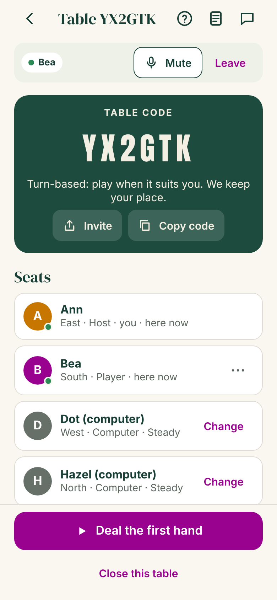
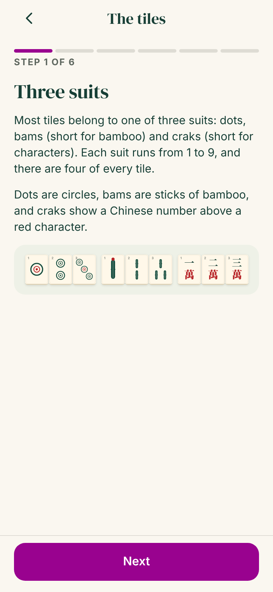
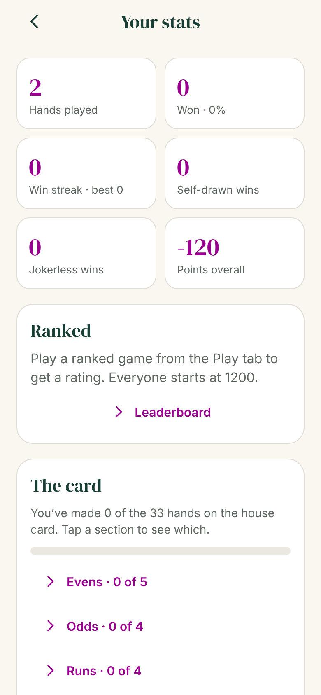

# Daily Rack

The American mahjong app that gets you from your first lesson to a real table, and keeps your table together once you have one. Learning apps are crowded, so Daily Rack is built around the two moments nobody serves well: the gap between lessons and open play, and playing with your actual people, whatever number you have. A short daily puzzle keeps players sharp between game nights.

- **Learn, then practise before you show up to a group.** Ten short lessons with Pip, the sparrow, then a **practice round**: an untimed hand against the computer where Pip coaches every pass, discard and call, with take-backs and a review at the end.
- **The daily rack.** Everyone gets the same deal each day, played at the game table at the moment the first Charleston starts. After your pass, every tile is ranked (best to pass in green) next to the strong pass and how everyone else passed. Then everyone plays the same three discards on from that hand, each one ranked, and shares a text score.
- **Play with your people, whatever number you have.** Full four-seat American mahjong (Charleston, courtesy pass, calling discards, jokers and joker swaps, Mahjong and payments) with friends or computer players, live or turn-based. Only three of you? A computer takes the empty seat. Just two? **Two-player games**: two hands each, no Charleston. Friends add each other by code and chat.
- **Game Night** gets everyone around a real table on the same date: time votes, RSVPs, a calendar file, and an online table as the fallback.
- **Play people online.** A quick match or a ranked game with strangers, live, one hand each. Computer players fill empty seats if nobody else turns up in time. Ranked play moves an Elo-style rating, and there are leaderboards for rating and for this week's points. Strangers chat in quick phrases only.
- **Voice chat** at private tables with friends (WebRTC, directly between devices).
- **Stats and progress:** hands, wins, streaks, biggest hand, rating and rank, recent hands, and which hands on the card you've made.
- **Offline play** against the computer, entirely on the device. Finished hands join your stats when you're back online.
- **Large-tile mode** with big corner numbers, and **extra cards**: a table can play with another card dropped into `content/cards` (see the README there).

It is one Expo app (Expo SDK 58) for iOS, Android and the web. There is no sign-in: each player is a guest on their device. A shared link opens in any phone browser with nothing to install. Players agree to community rules before chatting, messages are filtered, and anyone can be reported or blocked (see [`docs/MODERATION.md`](docs/MODERATION.md)).

Built from the product handoff in [`docs/handoff/`](docs/handoff/README.md). What is done, what is verified and what is still open is tracked in [`BUILD-STATUS.md`](BUILD-STATUS.md).

| Daily rack | Playing a hand | Hand result |
| --- | --- | --- |
|  |  |  |

| Charleston | Friends | Game Night |
| --- | --- | --- |
|  |  |  |

| Community rules | Reporting a message | Blocked players |
| --- | --- | --- |
|  |  |  |

| Voice chat | Lessons | Stats |
| --- | --- | --- |
|  |  |  |

Exported video frames (hook, a tile sliding out with captions, the closing question, the end card):


## How it is built

| Part | What it does | Tech |
| --- | --- | --- |
| `packages/core` | Daily rack rules: tile faces, puzzle and pass validation, the community split, streaks, the content calendar, the clip timeline and caption timing | TypeScript, no dependencies |
| `packages/core/src/mahjong` | The game: the 152-tile set, the house card and its pattern language, hand matching with jokers, a pure state machine for a hand (Charleston to payments), and computer players at three strengths | TypeScript, no dependencies |
| `apps/server` | Guest sessions, the daily rack API, share links, analytics, delete-my-data; plus tables (lobby, seats, live timers, bots), friends, chat, Game Night and a WebSocket for live updates | Node 22, Hono, built-in SQLite, `ws` |
| `apps/mobile` | The Expo app: Today, Play, Friends, Game Night and You tabs; rack, result and clip screens; the game table; link routes for shared racks (`/r/…`), tables (`/t/…`), friends (`/f/…`) and Game Night invites (`/n/…`) | Expo SDK 58, Expo Router, React Native 0.88, react-native-svg |
| `apps/mobile/src/clip` | Draws any moment of the 32-second clip on a canvas and encodes a 1080×1920, 30 fps MP4 on the device. Native builds run it in a WebView and hand the file to the share sheet or Photos. | Canvas 2D, WebCodecs via Mediabunny |
| `content/` | Daily racks as reviewed, immutable JSON revisions, plus the publication schedule | JSON |

Tile artwork is drawn in code (`apps/mobile/src/tiles/tileArt.ts`) with the Chinese characters converted to vector paths, so faces are always correct, no tile font is needed, and the app and the video use the same art.

## The game

- **Card.** Hands come from the original *Daily Rack House Card* (`packages/core/src/mahjong/card.ts`): 33 hands in eight sections, written in a small pattern language and expanded to every concrete suit and number combination. It follows standard American conventions but is not the National Mah Jongg League card.
- **Rules.** 152 tiles with 8 jokers and 8 flowers. East starts with 14. The Charleston passes right, across, left; a second Charleston (left, across, right) happens only if everyone agrees; then an optional courtesy pass across. Jokers can't be passed, are used only in groups of three or more, and can be swapped out of any exposure for the matching natural tile. A discard can be called for Mahjong or to expose a group; Mahjong beats an exposure and ties go to the next player in turn. The discarder of the winning tile pays double, others pay single; a self-drawn Mahjong collects double from everyone; jokerless hands double. An empty wall is a wall game.
- **Computer players.** Easy, Steady and Sharp. They plan toward the closest hands on the card, decide calls, swap jokers and pass sensibly in the Charleston. In tests, Steady players finish most four-computer hands with a Mahjong (86% over 200 seeded hands).
- **Live or turn-based.** Live tables give 90 s for a Charleston pass, 60 s for a turn and 12 s to call a discard; when time runs out, the computer makes a safe move for that player. Turn-based tables wait indefinitely. If someone leaves mid-hand, a computer player takes the seat so the game finishes.
- **The table.** You see it from your chair, like a club's automatic table: the player across holds their tiles up with the blue backs toward you, the players on either side are seen edge-on, and each player's discards lie in rows of six in front of them, turned their way, around a console whose lights show whose move it is. Other hands stay hidden until the hand ends, as at a real table. Your rack sits at the bottom with the current move just above it. It's drawn with ordinary React Native views and a slight perspective tilt, with no 3D engine.
- **Sounds.** Tiles clack when they hit the table, draws click softly, calls, passes, the deal and Mahjong each have their own sound, and phones tap back with haptics. The sounds are synthesized by `scripts/make-sounds.mjs`, with no recordings, so they're ours to ship. Run it again after changing a parameter. They follow the iPhone silent switch and can be turned off at the table or on the You tab.
- **Hints.** The table can show the three closest hands on the card for your tiles, with the exact tiles each one needs. Turn them off on the You tab.
- **Your own order.** Drag tiles in your rack into any order (a tap still picks a tile); the rack remembers it for the game, and "By suit" / "By number" are a tap away.
- **Dead hands and "why can't I call this?".** The engine calls a hand dead, from what everyone at the table can see, when its exposures fit no hand on the card or every hand left needs a pair or single that's used up. A dead hand sits out the rest of the hand and still pays the winner, and the table says why. Under any other player's discard, "Why can't I call…?" has Pip explain in plain English (a joker, a concealed hand, only a pair, not enough matching tiles, too late, and so on), using the same rules the game does.

## Two-player games

For couples and pairs of friends, against the computer or each other, live or turn-based, at a private table (choose "2" under "How many of you?" on the new-table form). Each player is dealt 27 tiles; East draws a 28th and discards. There is no Charleston. Each player builds two hands from the card at once, arranging hidden tiles between two racks; every exposure belongs to one hand. Your first Mahjong scores its card value and play goes on; your second ends the game and pays double. Jokerless doubles as usual, and an empty wall is a wall game. Joker swaps work on any exposure except a declared hand. The rules are our own, modelled on the published two-player game; we don't use its name, which is a registered trademark, or its card. Full rules and the decisions behind them: [`docs/TWO-PLAYER.md`](docs/TWO-PLAYER.md). Two-player games count as games played in stats but never touch ratings or leaderboards, and premium cards follow the same Plus rules as four-player tables.

## Learn to play, Pip and reminders

Mahjong is having a moment, and a lot of players are brand new, so the app is built to feel warm and friendly to them.

- **Pip**, an original sparrow (mahjong means "sparrow"), greets new players, cheers finished lessons and good racks with confetti, says something kind whatever the result, and explains rules at the table. Pip is drawn in SVG (`apps/mobile/src/components/Pip.tsx`) with seven moods and small animations, and respects reduced motion.
- **Learn tab.** The ten lessons as a winding path in four units, with practice stops between them: today's rack as a Charleston pass, a practice round with Pip, and a first full game against Steady computer players. A "Just the two of you?" lesson explains two-player games.
- **Practice round** (`/practice`, also on Play and Today). An untimed hand against Easy, Steady or Sharp computer players on the device, Charleston on by default. Pip's panel suggests a pass (the tiles are badged on your rack), names your best discards and gives a gentle heads-up before you throw a tile your closest hand needs, says whether to call a discard, and notes joker swaps and dead hands. "All discards" lists every tile with how far it leaves you and how many unseen tiles would help, best in green. Take back any move. The review shows what you went for, how often you matched Pip and the decision that cost most, then points to a real table: play with friends or plan a Game Night. Practice rounds stay out of stats. Plus members can practise on the 2026 card.
- **The coach** behind the practice round and the daily rack (`packages/core/src/mahjong/coach.ts`) judges a choice the way a teacher talks it through: tiles still needed for your nearest hand, unseen tiles that would bring it closer, and how many lines on the card stay that close. It takes a few milliseconds per decision.
- **Notifications.** "Your move" at turn-based tables (once until you play), table invites, friend requests, friends' messages (at most one a minute per chat), Game Night news, and "your game is ready" for matchmaking. Nothing is pushed while the app is open in front of you. Pip asks at a moment it makes sense, never on first launch, and each kind can be turned off on the You tab.
- **Reminders from Pip**, scheduled on the phone itself, Duolingo-style but gentler: one at the time you usually play (or a time you pick), a streak saver in the evening when your streak is on the line, and come-back nudges after 1, 2, 3, 5, 7 and 14 days that then stop. Game Nights you're going to get a reminder two hours before.

Push needs an Expo project: run `npx eas-cli@latest init` in `apps/mobile` (it writes `extra.eas.projectId` to `app.json`), then add an APNs key and an FCM V1 key with `eas credentials`. Until then, reminders on the phone still work and the server simply has no phones to send to.

## The daily rack

The day's puzzle (a reviewed revision from `content/puzzles`) is shown at the game table: you sit South with Hazel, Dot and Rosie around you, your 13 tiles on the game's rack (tap to choose, drag to arrange), and "First Charleston · Pass right · choose 3" in the action bar, with "What are you aiming for?" as section chips. Jokers can't be passed and your draft survives a reload. The review, inspired by discard trainers like mjlab's, ranks every tile in the deal by what passing it costs, marks your picks and the strong pass, and shows the community split once enough people have answered. Then "Play it on: three discards": Pip passes the strong three so everyone plays on from the same hand, the incoming tiles and draws are seeded from the revision id (`packages/core/src/mahjong/daily.ts`), and each discard is ranked by the coach. The score ("Discards 🟩🟩⬜") is saved on the device and shared as text with the rack's link. Video clips stay switched off.

## Daily Rack Plus (free tier and subscription)

New players should never meet a paywall before they can play, so the free tier is generous:

- **Free:** every lesson, unlimited games on the house card, games with friends, chat, Game Night and voice chat, quick matches, and 3 hands a day on the 2026 card against the computer.
- **Plus:** the 2026 card as much as you like, hosting friends on it (they play free), and ranked games with ratings and the leaderboard. Suggested prices: $5.99 a month or $39.99 a year with a 7-day free trial on the yearly plan.

The rules live in `packages/core/src/plans.ts`. The server enforces them (a 402 `plus_required` with the feature), and the app opens the Plus screen with Pip, the real store prices, "Always free", restore, the auto-renew fine print and a "Maybe later" that's always there. A free trial gets a local reminder two days before it ends. The web build explains that Plus comes with the phone apps.

Purchases go through RevenueCat (`react-native-purchases`). The RevenueCat project "Daily Rack" has iOS and Android apps for `app.dailyrack.mobile`, a `plus` entitlement, products `dailyrack_plus_monthly` and `dailyrack_plus_annual` (Google Play: `dailyrack_plus:monthly` and `dailyrack_plus:annual`), and a default offering with yearly and monthly packages. Development builds use RevenueCat's Test Store, so purchases can be tried without a store account; release builds use the App Store and Google Play. The public SDK keys are in `apps/mobile/app.json` under `extra.revenuecat`.

The server learns about purchases from RevenueCat's webhook (`POST /v1/webhooks/revenuecat`, checked against `REVENUECAT_WEBHOOK_AUTH`), and with `REVENUECAT_SECRET_KEY` it also asks RevenueCat directly after a purchase or webhook, as RevenueCat recommends. Restoring on a new phone moves Plus to the new guest. Moderators can give Plus by hand: `npm run reports -- plus <playerId> 30` (or `forever`, or `off`).

To start selling:
1. App Store Connect: a subscription group with `dailyrack_plus_monthly` and `dailyrack_plus_annual`, prices, and a 7-day free trial introductory offer on the yearly plan. Google Play Console: subscription `dailyrack_plus` with base plans `monthly` and `annual`.
2. RevenueCat: add the App Store Connect API key and In-App Purchase key to the iOS app, and a Play service account to the Android app.
3. RevenueCat: create a secret API key and set it on the server as `REVENUECAT_SECRET_KEY`.
4. Host a privacy policy and terms, and set `PRIVACY_URL` and `TERMS_URL` (iOS falls back to Apple's standard terms). Both stores want these linked next to a subscription.

## Feature switches

`packages/core/src/features.ts` switches whole features off without deleting them. Right now the daily rack is on and clips are off:

| Switch | What it hides when off |
| --- | --- |
| `dailyRack` | Today's rack and its result and daily discards, the streak and "racks solved" on the You tab, the rack practice in Learn, and shared rack links. Today leads with a game and Pip's lessons instead. Pip's daily reminder becomes the next lesson or a game, with no streak saver. Old `/rack`, `/result/…` and `/r/…` links open Today. |
| `clips` | "Make my clip" on a result (a Done button takes its place) and the clip screen. Clips need the daily rack too. |

The server keeps the daily rack API, share links and content, and reports the switches at `/v1/config` so the E2E run checks whichever state is live. To bring a feature back, set its switch to `true` and deploy; for the phone apps that also means a new build.

## iPad and big screens

iPads turn freely (phones stay upright), and Android tablets are unlocked at startup. On big screens the tabs move to a sidebar, Today, Play and You use two columns, sheets open as centered cards, tiles grow, and the game table puts the felt on the left with your rack and moves on the right in landscape.

## Hosting

Production runs on Railway in the project **daily-rack** (service `daily-rack`, environment `production`):

| Setting | Value |
| --- | --- |
| Source | `TayoAki/mahjong4U`, branch `claude/lucid-dirac-krfama`; every push that touches `daily-rack/` redeploys. Switch the branch to `main` once this work is merged. |
| Root directory | `/daily-rack` |
| Build / start | Railpack (Node 22): `npm run build`, then `npm start` |
| Health check | `/v1/config` |
| Volume | `daily-rack-data` mounted at `/data`; the database is `/data/daily-rack.db` |
| Replicas | 1. Live games, timers and sockets live in one process, so don't scale it out. |
| Variables | `DATABASE_PATH`, `PUBLIC_BASE_URL`, `ADMIN_TOKEN`, `DEV_ROTATE=1` (until there are enough scheduled racks), `BOT_DELAY_MS`, `RAILPACK_NODE_VERSION=22`. Add `SUPPORT_EMAIL` and `REPORT_WEBHOOK_URL` in the Railway dashboard. |

The service's settings live on Railway rather than in a repo file (Railway no longer reads `railway.json` for new services). The moderator token is the `ADMIN_TOKEN` variable on the service. Turn on scheduled backups for the `daily-rack-data` volume in the Railway dashboard so a bad deploy can't lose players' data.

## Player safety

Chat makes this an app with user-generated content, so it has what the App Store asks for (Guideline 1.2). The full runbook is in [`docs/MODERATION.md`](docs/MODERATION.md).

- **Community rules.** Before the first message, friend request or Game Night, players agree to rules with zero tolerance for abuse. The server enforces it.
- **Filter.** Messages, player names and Game Night details are checked for profanity and slurs, including disguised spellings.
- **Report.** Tap a message, or the ⋯ next to any player, to report it with a reason. A reported message disappears for the reporter at once, and for everyone after two separate reports.
- **Block.** Blocking works both ways: no messages, requests, shared tables or game nights. Unblock on the You tab.
- **Moderators.** `npm run reports` lists open reports with the exact text; dismiss, remove the message, or suspend the player. An optional webhook posts each new report to Slack or Discord. Reports must be reviewed within 24 hours.

## Report a problem

Players report bugs from the You tab, from the How to play sheet at any table, or from the crash screen. The app attaches the screen they were on, the device, OS and app version, a few settings and the app's recent errors, plus an optional screenshot (taken of the table on phones, or picked from Photos anywhere). Players see everything that's sent first. Read them with `npm run reports -- bugs` and `npm run reports -- bug <id>` (which saves the screenshot); details in [`docs/MODERATION.md`](docs/MODERATION.md#problem-reports).

## Run it

Requires Node 22.13 or newer.

```bash
npm install
npm test                       # unit and API tests
npm run build                  # export the Expo web build to apps/mobile/dist
DEV_ROTATE=1 npm start         # serves the web app and API on http://localhost:8787
```

### The live server

The server runs on Railway at **https://daily-rack-production.up.railway.app** (the web version of the app is served from the same address). See [Hosting](#hosting) below.

### On your iPhone from a GitHub Codespace

The quickest way to try the app on a phone uses the live server, so only the Expo dev server runs in the Codespace:

```bash
API_URL=https://daily-rack-production.up.railway.app npm run phone
```

To run your own copy of the server in the Codespace instead, leave out `API_URL`. A phone can't reach a Codespace's `localhost`, so both the Expo dev server (port 8081, the app's code) and the API (port 8787) need public URLs. The repo's dev container forwards both ports, and one command does the rest:

```bash
npm run phone
```

It builds the web app if needed, starts the API, tries to make ports 8787 and 8081 public, and starts Expo with `EXPO_PUBLIC_API_URL` and `EXPO_PACKAGER_PROXY_URL` pointing at the Codespace's `https://<codespace>-<port>.app.github.dev` addresses. Install **Expo Go** from the App Store, then scan the QR code with the iPhone Camera.

- If it says it couldn't make the ports public, open the **Ports** tab, right-click 8787 and 8081, and choose **Port Visibility > Public**. Anyone with those links can reach them while the Codespace runs.
- If Expo Go can't load the app through the forwarded port, use Expo's tunnel for the dev server instead: run `npx expo login` once (free Expo account), then `TUNNEL=1 npm run phone`. The API still goes through port 8787.
- The Codespace stops after a period of inactivity, and the URLs only work while it runs. TestFlight and App Store builds use the live server: set `EXPO_PUBLIC_API_URL=https://daily-rack-production.up.railway.app` at build time.

### On your own computer

Run the API as above, then start Expo pointing at your computer's LAN address, with the phone on the same Wi-Fi:

```bash
cd apps/mobile
EXPO_PUBLIC_API_URL=http://192.168.1.20:8787 npx expo start
```

`npm run dev` runs the API with reload and the Expo dev server together.

`DEV_ROTATE=1` serves a daily rack every day by rotating through the content. Without it, only days listed in `content/schedule.json` have a rack, and other days show "The next rack is on its way". Games, friends and Game Night work every day.

### Environment

| Variable | Default | Meaning |
| --- | --- | --- |
| `PORT` | `8787` | HTTP port |
| `DATABASE_PATH` | `data/daily-rack.db` | SQLite file |
| `CONTENT_DIR` | `content` | Puzzles and schedule |
| `WEB_DIST` | `apps/mobile/dist` | Expo web build the server hosts (restart the server after rebuilding) |
| `PUBLIC_BASE_URL` | unset | Public origin for share and invite links, such as `https://dailyrack.app`. When set, the clip's end card shows the short link. |
| `BRAND_NAME` | `Daily Rack` | Name on the end card |
| `SPLIT_THRESHOLD` | `30` | Answers needed before rates are shown |
| `BOT_DELAY_MS` | `900` | Pause before each computer move, so people can follow the play |
| `MATCH_FILL_CASUAL_MS`, `MATCH_FILL_RANKED_MS` | `20000`, `45000` | How long the first person waiting for a public match waits before computer players fill the empty seats |
| `TURN_URLS`, `TURN_USERNAME`, `TURN_CREDENTIAL` | unset | A TURN relay for voice chat (comma-separated URLs). Public STUN servers are used either way, and TURN helps players on strict networks connect. |
| `DEV_ROTATE` | unset | `1` rotates content on unscheduled days |
| `NODE_ENV` | unset | `production` marks session cookies Secure |
| `ADMIN_TOKEN` | unset | Secret for the moderator endpoints and `npm run reports`. Unset means no moderator access. |
| `REPORT_WEBHOOK_URL` | unset | Slack or Discord incoming webhook that hears about each new report |
| `REVENUECAT_WEBHOOK_AUTH` | unset | The Authorization header value RevenueCat sends with each webhook. Unset turns the webhook off. |
| `REVENUECAT_SECRET_KEY` | unset | RevenueCat secret API key, so the server can look a subscriber up itself |
| `PLUS_FOR_EVERYONE` | unset | `1` gives everyone Plus (a beta, or before the stores are set up) |
| `PRIVACY_URL`, `TERMS_URL` | unset | Linked from the Plus screen |
| `PUSH_DISABLED` | unset | `1` stops push notifications. Otherwise they go through Expo's push service to phones that registered. |
| `EXPO_ACCESS_TOKEN` | unset | Only needed if "enhanced push security" is turned on for the Expo project |
| `SUPPORT_EMAIL` | unset | Contact address shown with the Contact us form on the You tab (App Store review expects one) |
| `EXPO_PUBLIC_API_URL` | same origin on web, `http://localhost:8787` on native | Where the app finds the API (set at Expo build time) |

## Scripts

| Command | What it does |
| --- | --- |
| `npm test` | Core, game engine and API tests (Vitest) |
| `npm run typecheck` | Type-check core, server and the Expo app |
| `npm run build` | Export the Expo web build |
| `npm run phone` | In a GitHub Codespace: start the API and Expo with public URLs so Expo Go on a phone can open the app |
| `npm run content:check` | Validate all puzzles and the schedule; lists any not yet teacher-reviewed |
| `npm run seed:demo -- [revisionId] [count]` | Add labelled demo answers so the split can be seen in development |
| `node scripts/make-sounds.mjs` | Rebuild the table sounds in `apps/mobile/assets/sounds` (synthesized, deterministic) |
| `npm run reports` | Review player reports: list, dismiss, remove a message, suspend or unsuspend; `npm run reports feedback` lists Contact us messages; `npm run reports -- bugs` lists problem reports and `bug <id>` shows one with its screenshot (needs `ADMIN_TOKEN`, and `API_URL` for a remote server) |
| `npm run e2e` | Drive the web build in headless Chromium on phone viewports: first open, the daily rack at the table with its ranked review, three daily discards and the share text (and a real MP4 export when clips are on), a full hand against the computer, a practice round with Pip (Pip's pass, All discards, a take-back), a two-player game against the computer, two guests becoming friends and chatting, the same two playing a live hand together, a Game Night from invite to calendar file, and the safety tools (rules, filter, report, block, unblock). Start the server on a fresh database with `BOT_DELAY_MS=120` first. With the daily rack or clips switched off, it checks they stay hidden instead. Set `E2E_SKIP_CLIP=1` to skip the video export, and `E2E_ADMIN_TOKEN` to the server's `ADMIN_TOKEN` to check the moderator view too. |

## Adding a daily rack

1. Add `content/puzzles/<puzzle-id>.json`, with 13 tiles, 2 or more sections and a suggestion with a reason for each tile. Copy an existing file.
2. Set `review.teacherReviewed` to `true` only after a qualified teacher has approved it. Unreviewed racks show a practice notice.
3. Schedule it in `content/schedule.json`.
4. Run `npm run content:check`.

A published revision can never be edited in place: the server refuses to start if a revision's content changes. To correct a rack, publish `-r2` and point the schedule at it.

## Card rights

Public, ranked and offline games use the original house card, and daily racks name sections in general terms. The 2026 card (`content/cards/card-2026.json`) was added at the owner's request and is sold as part of Plus; the National Mah Jongg League's terms ask for written consent before its card content is used in software (see `content/cards/README.md`). Get a lawyer's review before launch.
