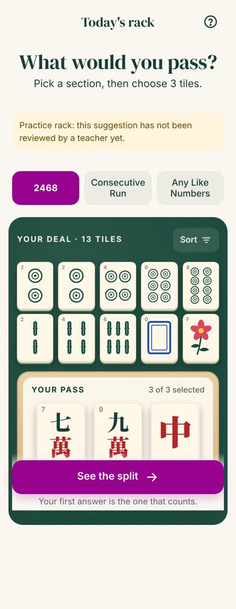
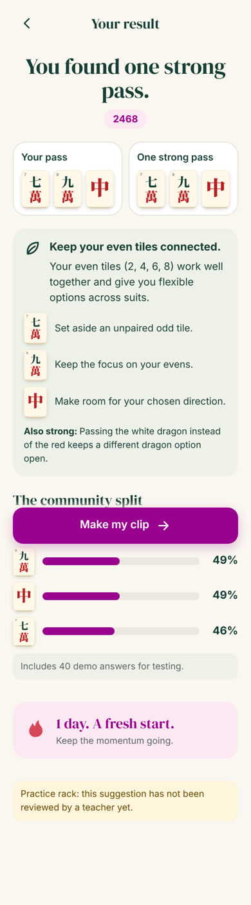
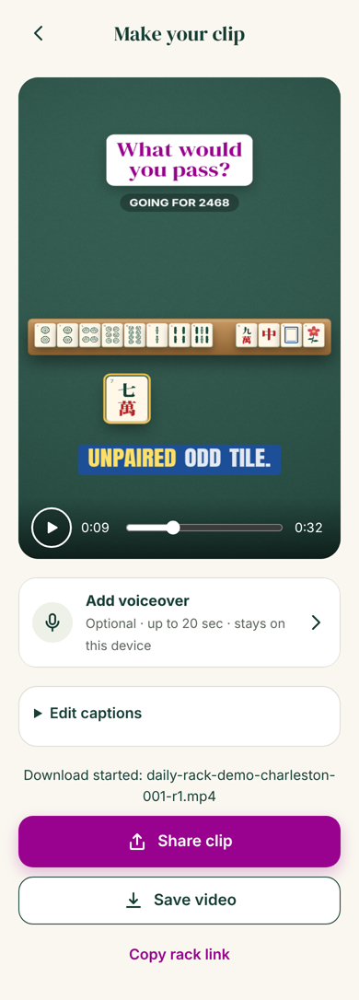

# Daily Rack

A daily American mahjong rack puzzle. Everyone gets the same 13-tile deal each day. You pick a section, pass three tiles, compare your pass with one strong pass and with how everyone else passed, then export your answer as a 9:16 clip for Reels or TikTok.

Built from the product handoff in [`docs/handoff/`](docs/handoff/README.md). What is done, what is verified and what is still open is tracked in [`BUILD-STATUS.md`](BUILD-STATUS.md).

| Rack | Result | Clip |
| --- | --- | --- |
|  |  |  |

Exported video frames (hook, a tile sliding out with captions, the closing question, the end card):


## How it is built

A web app first, so a shared link plays instantly in any phone browser with nothing to install. The same app can be wrapped for the App Store and Google Play later.

| Part | What it does | Tech |
| --- | --- | --- |
| `packages/core` | Tile faces, puzzle and pass validation, the community split, streaks and the content calendar, the clip timeline and caption timing | TypeScript, no dependencies |
| `apps/server` | Guest sessions, daily rack, one counted answer per player (idempotent and safe to retry), results, split, progress, share links, analytics events, delete-my-data | Node 22, Hono, built-in SQLite |
| `apps/web` | Today, Rack, Result, Clip and You screens, plus the shared-rack route `/r/:token` | React 19, Vite, React Router |
| `apps/web/src/clip` | Draws any moment of the 32-second clip on a canvas and encodes a 1080×1920, 30 fps MP4 on the device | Canvas 2D, WebCodecs via Mediabunny |
| `content/` | Puzzles as reviewed, immutable JSON revisions, plus the publication schedule | JSON |

Tile artwork is drawn in code (`apps/web/src/tiles/tileArt.ts`), so faces and pip counts are always correct, and the app and the video use the same art. Fonts are OFL-licensed: DM Serif Display, Anton, and a 16-glyph subset of Noto Serif SC for tile characters.

## Run it

Requires Node 22.13 or newer.

```bash
npm install
npm test                       # unit and API tests
npm run build                  # build the web app
DEV_ROTATE=1 npm start         # serves the app and API on http://localhost:8787
```

For live reload while developing, run `DEV_ROTATE=1 npm run dev`, then open http://localhost:5173. Vite proxies `/v1` to the API.

`DEV_ROTATE=1` serves a rack every day by rotating through the content. Without it, only days listed in `content/schedule.json` have a rack, and other days show "The next rack is on its way".

### Environment

| Variable | Default | Meaning |
| --- | --- | --- |
| `PORT` | `8787` | HTTP port |
| `DATABASE_PATH` | `data/daily-rack.db` | SQLite file |
| `CONTENT_DIR` | `content` | Puzzles and schedule |
| `PUBLIC_BASE_URL` | unset | Public origin for share links, such as `https://dailyrack.app`. When set, the clip's end card shows the short link. When unset, no URL is shown. |
| `BRAND_NAME` | `Daily Rack` | Name on the end card |
| `SPLIT_THRESHOLD` | `30` | Answers needed before rates are shown |
| `DEV_ROTATE` | unset | `1` rotates content on unscheduled days |
| `NODE_ENV` | unset | `production` marks session cookies Secure |

## Scripts

| Command | What it does |
| --- | --- |
| `npm test` | Core and API tests (Vitest) |
| `npm run typecheck` | Type-check every package |
| `npm run content:check` | Validate all puzzles and the schedule; lists any not yet teacher-reviewed |
| `npm run seed:demo -- [revisionId] [count]` | Add labelled demo answers so the split can be seen in development. The app shows "Includes N demo answers". |
| `npm run e2e` | Drive the full guest loop in headless Chromium on a phone viewport, export a real MP4 with and without a voiceover, and check it with `ffprobe`. Start the server on a fresh database first. |

## Adding a puzzle

1. Add `content/puzzles/<puzzle-id>.json`, with 13 tiles, 2 or more sections and a suggestion with a reason for each tile. Copy an existing file.
2. Set `review.teacherReviewed` to `true` only after a qualified teacher has approved it. Unreviewed racks show a practice notice.
3. Schedule it in `content/schedule.json`.
4. Run `npm run content:check`.

A published revision can never be edited in place: the server refuses to start if a revision's content changes. To correct a rack, publish `-r2` and point the schedule at it.

## Card rights

The app never shows or copies the National Mah Jongg League card. Racks name sections in general terms, explanations are original, and players check hands against their own card. Get a lawyer's review before launch.
